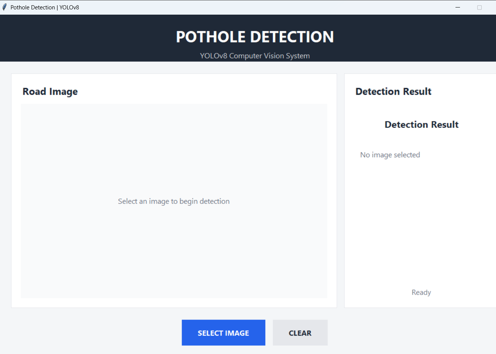
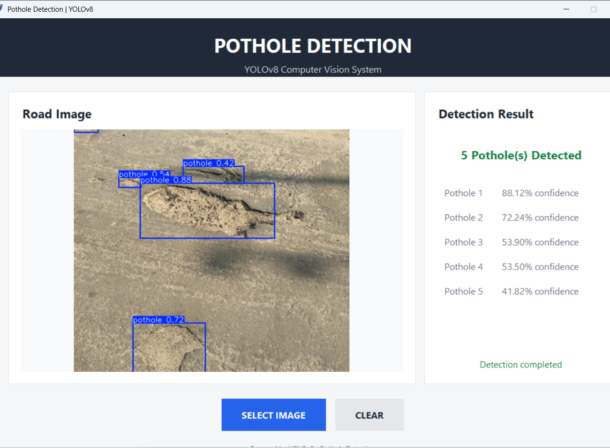

# Pothole Detection Using YOLOv8

## 1. Project Overview

This project detects potholes in road images using the YOLOv8 object detection model.

The system identifies potholes, draws bounding boxes around them, and provides a confidence score for each detection.

## 2. Objective

The objective of this project is to automatically detect potholes from road images using computer vision and deep learning.

## 3. Technologies Used

- Python 3.10
- YOLOv8
- Ultralytics
- PyTorch
- Pillow
- OpenCV
- Tkinter

## 4. Dataset

The dataset contains road images and corresponding YOLO annotation files.

The dataset is divided into:

- Training data
- Validation data
- Testing data

The project contains one class:

- Pothole

## 5. Model Training

The YOLOv8n model was trained using the pothole dataset for 20 epochs.

The trained model weights are saved as:

`best.pt`

## 6. Model Evaluation

The trained model produced the following validation results:

- Precision: 0.84
- Recall: 0.642
- mAP50: 0.769
- mAP50-95: 0.484

## 7. Prediction

The trained `best.pt` model is used to detect potholes in new road images.

The output contains:

- Bounding boxes
- Pothole class
- Confidence scores

## 8. Application

A simple GUI was developed using Tkinter.

The user can select a road image, and the application displays the detected potholes along with their confidence scores.
### Application Interface

### Pothole Detection Results

## 9. Project Structure

PotholeDetection/

├── app.py  
├── train.py  
├── predict.py  
├── requirements.txt  
├── README.md  
├── yolov8n.pt  
└── runs/

## 10. Future Improvements

- Increase the size and diversity of the dataset
- Improve detection accuracy
- Test the model on real-time video
- Deploy the model on a mobile or web application
- Add severity classification for potholes